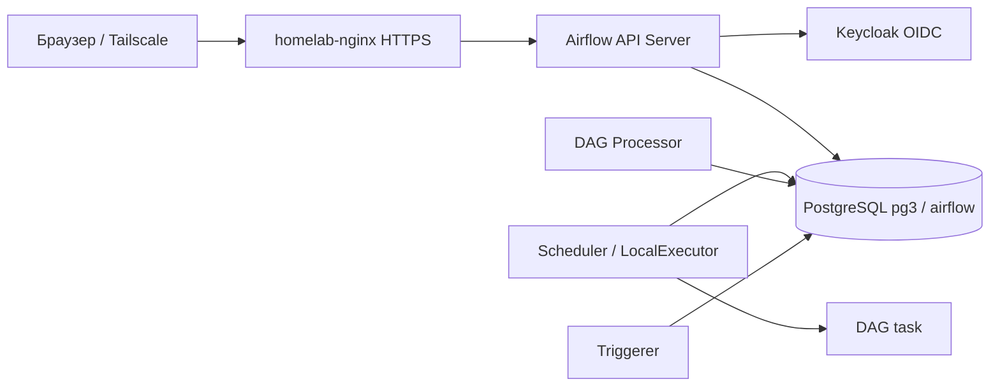

# Homelab Airflow — Apache Airflow 3.1.8 + Keycloak

Локальный оркестратор Data Engineering Platform на HP-сервере (Ubuntu 24.04, Docker Compose). Используется **Apache Airflow 3.1.8**, исполнитель **LocalExecutor**, PostgreSQL **pg3** и существующая система авторизации **Keycloak**. Интерфейс доступен через общий Nginx по адресу **https://airflow.handyman.moscow**.

Назначение: разработка и тестирование DAG, расписаний, ETL/ELT-конвейеров, интеграционных задач и будущих сценариев управления Spark/Iceberg. Это **личная лаборатория**, а не отдельный production-кластер с Celery и распределёнными Worker.

Связанные репозитории: [Outline / инфраструктура](https://github.com/glazole/outline_wiki), [Spark + Iceberg + JupyterHub](https://github.com/glazole/homelab-sparkice), [PostgreSQL + ClickHouse + Metabase](https://github.com/glazole/homelab-analytics-stack).

## 1. Архитектура

| Компонент | Роль |
|---|---|
| Airflow API Server | Веб-интерфейс, REST API, авторизация через Keycloak |
| Airflow Scheduler | Планирование и запуск DAG |
| Airflow DAG Processor | Парсинг DAG-файлов |
| Airflow Triggerer | Асинхронные триггеры для deferrable operators; определён в Compose |
| Airflow Init | Одноразовая миграция БД `airflow db migrate` |
| PostgreSQL pg3 | Уже существующая БД `airflow`, роль `airflow_app` |
| Keycloak | Уже существующий realm и выделенный OIDC-клиент `airflow` |
| Nginx | Уже существующий `homelab-nginx`, HTTPS |
| LocalExecutor | Выполнение задач локально в среде Airflow, **без Celery, Redis и отдельных Celery Workers** |



Две **внешние** Docker-сети:

- `homelab-db` — Airflow ↔ `pg3:5432`;
- `outline-network` — API Server и CLI ↔ существующие Nginx/Keycloak.

Port `8080` не публикуется напрямую на HP-сервере; доступ через Nginx. Базовые pg1–pg3, Keycloak, Outline и RustFS не поднимаются повторно данным Compose.

**Важное уточнение о Triggerer:** сервис `airflow-triggerer` **описан** в `docker-compose.yml` и реально запускался на HP, но текущие `start.sh` и `stop.sh` перечисляют только API Server, Scheduler и DAG Processor. Поэтому запуск/остановку Triggerer следует выполнять **отдельно**, если нужен именно он. Для стандартных LocalExecutor DAG он необязателен.

## 2. Структура

```text
airflow/
├── README.md
├── Dockerfile
├── docker-compose.yml
├── .env.example
├── .gitignore
├── .dockerignore
├── prepare.sh
├── start.sh
├── stop.sh
├── status.sh
├── install-nginx.sh
├── nginx/airflow.conf
├── dags/homelab_smoke_test.py
├── plugins/
├── logs/
└── certs/
```

Пути `dags/` и `plugins/` примонтированы **read-only**, `logs/` — для записи. Локальные `.env`, сертификаты и логи не должны попадать в Git.

## 3. Зависимости и предварительная проверка

Нужны: Docker Engine + Compose v2, Python 3 на хосте, PostgreSQL `pg3` с БД `airflow`, работающий Keycloak, доверенный корневой CA из проекта Outline и общий Nginx. Сертификат должен покрывать `airflow.handyman.moscow`. DNS работает через Tailscale/dnsmasq в существующем Homelab.

```bash
docker compose version
docker network inspect homelab-db >/dev/null
docker network inspect outline-network >/dev/null
docker inspect pg3 --format '{{.State.Health.Status}}'
docker ps --format 'table {{.Names}}\t{{.Status}}'
```

Код и скрипты рассчитаны на локальный путь **`~/projects/homelab/airflow`**, расположенный рядом с `outline_wiki`. Клонируйте репозиторий с этим именем каталога:

```bash
cd ~/projects/homelab
git clone git@github.com:glazole/homelab-airflow.git airflow
cd airflow
chmod +x ./*.sh
```

Если каталог уже существует, **не клонируйте поверх него**: перед обновлением выполнить `git status`.

## 4. Первый запуск

### Шаг 1. Подготовить .env, pg3 и сертификат

```bash
cd ~/projects/homelab/airflow
./prepare.sh
```

Скрипт:

1. создаёт `.env` из `.env.example` и генерирует пароли / ключи (если файла нет);
2. копирует **только публичный CA** `../outline_wiki/nginx/certs/rootCA.pem` в `certs/homelab-rootCA.crt`;
3. подключается к `pg3`, создаёт/обновляет роль `airflow_app`, назначает её владельцем БД `airflow` и выдаёт необходимые права на схему `public`;
4. не выполняет миграцию Airflow (она запускается позже).

Существующий `.env` не перезаписывается. **Повторный `prepare.sh` обновляет пароль PostgreSQL-роли `airflow_app` по текущему .env**, поэтому не меняйте значение секрета наугад.

В `.env` должны быть:

| Переменная | Назначение |
|---|---|
| `AIRFLOW_UID` | UID пользователя файловой системы контейнера |
| `AIRFLOW_DB_PASSWORD` | Пароль роли `airflow_app` в pg3 |
| `AIRFLOW_FERNET_KEY` | Шифрование Airflow Connections / Variables |
| `AIRFLOW_API_SECRET_KEY`, `AIRFLOW_INTERNAL_API_SECRET_KEY`, `AIRFLOW_JWT_SECRET` | Секреты API и внутреннего взаимодействия |
| `KEYCLOAK_SERVER_URL` | `https://keycloak.handyman.moscow` |
| `KEYCLOAK_REALM` | Имя **существующего** realm |
| `KEYCLOAK_CLIENT_ID` | `airflow` |
| `KEYCLOAK_CLIENT_SECRET` | Секрет выделенного клиента |

Не отправляйте содержимое `.env` или логины/пароли в чат, Git или скриншоты.

### Шаг 2. OIDC-клиент в Keycloak

Администрирование: **https://keycloak.handyman.moscow**. Создать **новый** клиент в уже работающем realm; остальных клиентов не менять.

| Keycloak | Значение |
|---|---|
| Client ID | `airflow` |
| Protocol | OpenID Connect |
| Client authentication | ON |
| Authorization | ON — необходим Keycloak Auth Manager |
| Standard flow | ON |
| Implicit flow | OFF |
| Root/Home URL | `https://airflow.handyman.moscow` |
| Valid redirect URIs | `https://airflow.handyman.moscow/*` |
| Valid post-logout redirect URIs | `https://airflow.handyman.moscow/*` |
| Web origins | `https://airflow.handyman.moscow` |

Из Client Credentials скопировать secret в локальный `.env`:

```ini
KEYCLOAK_REALM=<existing-realm>
KEYCLOAK_CLIENT_SECRET=<new-client-secret>
```

Непосредственно из контейнера Airflow должен быть доступен Keycloak по публичному HTTPS-имени, а CA — доверенным. Нельзя «исправлять» OIDC, отключая TLS-проверку.

### Шаг 3. Собрать образ и выполнить миграцию

```bash
cd ~/projects/homelab/airflow
docker compose config --quiet
./start.sh
```

Скрипт проверяет `.env`, CA, доступность сетей и состояние `pg3=healthy`, собирает образ `handyman-airflow:3.1.8-keycloak` при отсутствии, затем выполняет:

```bash
docker compose run --rm airflow-init
docker compose up -d airflow-api-server airflow-scheduler airflow-dag-processor
```

Миграцию БД делает контейнер `airflow-init`. **На первом запуске это может занять время.**

Проверка:

```bash
./status.sh
docker compose ps
docker compose logs --tail=100 airflow-api-server
docker compose logs --tail=100 airflow-scheduler airflow-dag-processor
```

Если изменился `Dockerfile`, перед запуском можно пересобрать образ:

```bash
docker compose build --pull
./start.sh
```

#### Triggerer (по желанию)

В реальном развёртывании на HP Triggerer запускался. Однако `start.sh` и `stop.sh` пока не управляют этим сервисом. Для использования deferrable operators:

```bash
docker compose up -d airflow-triggerer
docker compose logs --tail=80 airflow-triggerer

# Остановить отдельно, когда он больше не нужен
docker compose stop airflow-triggerer
```

### Шаг 4. Настроить Nginx и DNS

Существующий Nginx должен обслуживать `airflow.handyman.moscow` и быть подключён к `outline-network`. DNS в текущем стенде разрешает поддомены на Tailscale IP HP-сервера.

```bash
cd ~/projects/homelab/airflow
./install-nginx.sh

docker exec homelab-nginx nginx -t
docker exec homelab-nginx getent hosts airflow-api-server
docker exec airflow-api-server getent hosts pg3
curl -k -I https://airflow.handyman.moscow/
```

`install-nginx.sh` переносит **один** серверный блок `nginx/airflow.conf` в `../outline_wiki/nginx/conf.d/airflow.conf`, проверяет конфигурацию и перезагружает существующий Nginx. При повторной установке умеет создать `.bak` предыдущего файла. Проверьте отсутствие других блоков для этого hostname.

`curl -k` допустим **только как диагностический тест** при частном сертификате; для штатной работы нужно доверие к собственному CA.

### Шаг 5. Создать разрешения Keycloak Auth Manager

**Аутентификация и авторизация различаются.** Успешный вход через Keycloak сам по себе не означает наличие прав просмотра DAG.

Согласно конфигурации используется `airflow.providers.keycloak.auth_manager.keycloak_auth_manager.KeycloakAuthManager`. Его авторизационные сущности нужно создать в соответствующем клиенте:

```bash
cd ~/projects/homelab/airflow

# Сначала dry-run
docker compose run --rm airflow-cli \
  keycloak-auth-manager create-all --username admin --dry-run

# Затем применение
docker compose run --rm airflow-cli \
  keycloak-auth-manager create-all --username admin
```

Команда запрашивает доступ администратора Keycloak. Если он находится не в стандартном realm, потребуется параметр `--user-realm`. После создания ресурсов назначить своему пользователю **подходящую роль клиента**. Не предоставлять административный доступ всем пользователям.

Официальная документация: [Airflow Keycloak Auth Manager](https://airflow.apache.org/docs/apache-airflow-providers-keycloak/stable/auth-manager/manage/login.html).

### Шаг 6. Проверить DAG

Перейти в **https://airflow.handyman.moscow**, авторизоваться через Keycloak, найти `homelab_smoke_test` и запустить его **вручную** — у него `schedule=None`.

Проверка должна показать успешное выполнение LocalExecutor task. Логи теста содержат:

```text
Airflow 3 LocalExecutor: task executed successfully
```

Это проверяет чтение DAG, работу Scheduler/LocalExecutor, запись состояния в pg3 и отображение логов через API Server. Наличие сервиса Triggerer не требуется для данного smoke test.

## 5. Повседневные операции

**Запустить базовые компоненты**:

```bash
cd ~/projects/homelab/airflow
./start.sh
```

Следует учитывать, что `start.sh` каждый раз выполняет `airflow db migrate` через `airflow-init`; для обычного рестарта без обновления схемы можно ограничиться:

```bash
docker compose up -d \
  airflow-api-server airflow-scheduler airflow-dag-processor
```

**Запустить Triggerer**:

```bash
docker compose up -d airflow-triggerer
```

**Статус и логи**:

```bash
./status.sh
docker compose ps
docker compose logs --tail=100 airflow-api-server airflow-scheduler airflow-dag-processor airflow-triggerer
```

**Остановить Airflow**:

```bash
./stop.sh
docker compose stop airflow-triggerer
```

В текущем коде `stop.sh` останавливает **только API Server, Scheduler и DAG Processor**. Команда выше дополнительно завершает Triggerer. Не останавливайте `pg3`, пока он используется Airflow или другими сервисами.

**Обновить код DAG**: сохранить файл в `dags/` и дождаться обработки DAG Processor; папка подключена как volume. Не требуется пересборка образа только из-за Python DAG.

**Пересобрать образ** после изменения Dockerfile/requirements:

```bash
docker compose build --pull
docker compose up -d --force-recreate \
  airflow-api-server airflow-scheduler airflow-dag-processor
```

Проверять совместимость установленных provider-пакетов с Airflow 3.1.8; на практике неконтролируемые обновления зависимостей могут нарушить сборку.

## 6. Ограничения вычислений

`docker-compose.yml` выставляет консервативные параметры:

| Параметр | Значение |
|---|---|
| Executor | `LocalExecutor` |
| Parallelism | `2` |
| Max active tasks per DAG | `2` |
| Max active runs per DAG | `1` |
| Scheduler parsing processes | `1` |
| API Workers | `1` |

Этот режим подходит для личных DAG и тестовых пайплайнов. Ресурсоёмкие расчёты целесообразно выносить в Spark, а Airflow использовать для оркестрации, но готовую интеграцию Spark-оператора данный проект **не заявляет**.

Для наблюдения за ресурсами:

```bash
free -h
docker stats --no-stream \
  --format 'table {{.Name}}\t{{.MemUsage}}\t{{.CPUPerc}}'
```

## 7. Распространённые неполадки

| Симптом | Что проверить |
|---|---|
| `pg3 не healthy` | Контейнер PostgreSQL, БД `airflow`, сеть `homelab-db` |
| `Нет .env / KEYCLOAK_REALM` | `./prepare.sh` и клиент `airflow` в существующем Keycloak |
| Ошибка OAuth/SSL | Адрес realm, redirect URI, trust chain CA в контейнере |
| Успешный логин, пустой список DAG или 403 | Роли и Authorization resources в Keycloak Auth Manager |
| HTTP 502 от Nginx | `docker compose ps`, `airflow-api-server`, `nginx -t`, Docker DNS |
| DAG не появляется | Файл в `dags/`, логи `airflow-dag-processor` |
| Задание не запускается | Логи `airflow-scheduler`, ограничения параллельности |
| Triggerer не виден в `docker compose ps` | Текущий `start.sh` его не поднимает — запускать отдельно |
| Ошибка миграции БД | Логи `airflow-init`, PostgreSQL-доступ, версии Airflow/providers |

## 8. Безопасность и сохранность данных

- `.env` хранит доступ к pg3, Keycloak и ключи шифрования. Права на файл должны быть ограничены; **не коммитить**.
- `Airflow Fernet Key` используется для зашифрованных значений. Его смена без процедуры ротации может сделать ранее сохранённые Connections/Variables нечитаемыми.
- `LocalExecutor` исполняет код DAG с правами локальных процессов Airflow. Не допускать загрузки неподконтрольных DAG.
- `FORWARDED_ALLOW_IPS="*"` допустим лишь при доверенном окружении за Nginx; не открывать API Server напрямую в Интернет.
- Сохранять БД `pg3.airflow`, `.env`, `dags/`, `logs/` и необходимые конфигурации; **Git-репозитория недостаточно** для восстановления.
- Не использовать `docker compose down -v` как обычную остановку; не менять Keycloak realm/клиента и секреты без понимания влияния на SSO.
- Keycloak Auth Manager требует внимательной проверки совместимости версий и полномочий перед доступом внешних пользователей.

## 9. Что подтверждено в Homelab

К октябрю 2026 на HP-сервере работали контейнеры **Airflow API Server, Scheduler, DAG Processor и Triggerer**; использовались PostgreSQL pg3 и HTTPS через существующий Nginx. Описание четырёх контейнеров основано на фактическом выводе `docker ps`, а не только на проектном Compose.

README различает **наблюдавшуюся конфигурацию** и то, что делает текущий `start.sh`: последний запускает только три основных сервиса. Повторная проверка E2E smoke test, восстановление из резервной копии и обновление провайдеров должны выполняться отдельно.

---

Другие компоненты платформы: [outline_wiki](https://github.com/glazole/outline_wiki) · [homelab-sparkice](https://github.com/glazole/homelab-sparkice) · [homelab-analytics-stack](https://github.com/glazole/homelab-analytics-stack).
